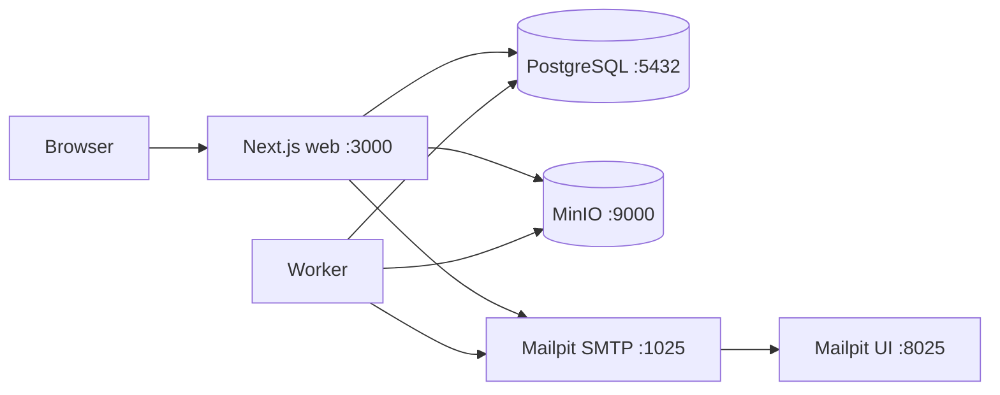
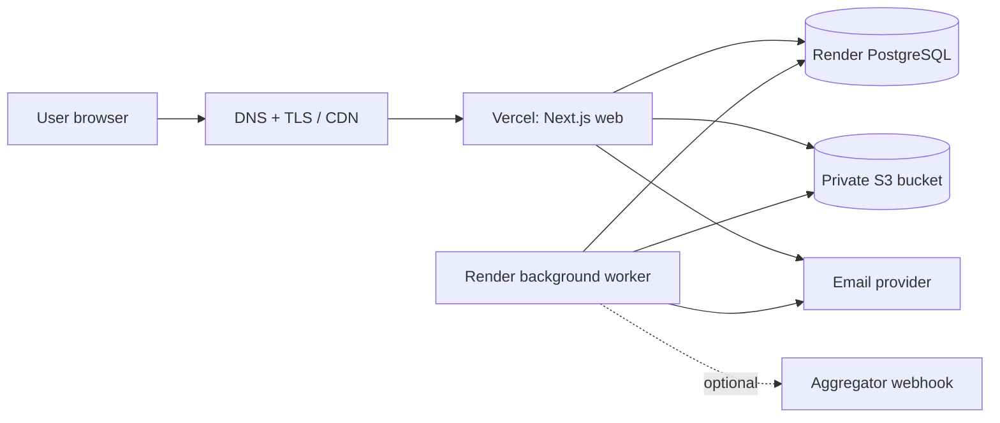

# CureNear Provider Onboarding Portal — handover and deployment guide

Audience labels: **[Developer]**, **[DevOps]**, **[Project owner]**, **[All]**.

This guide describes the repository as it exists on 2026-11-22. Where a step could not be
executed in the preparation environment it is marked **Not verified**. Docker was not available
on the preparation machine, so image builds and compose runs are documented but not executed
there. The production Next build, a production-mode local start and the smoke script were run.

## Contents

1. [Overview and architecture](#1-overview-and-architecture)
2. [Prerequisites](#2-prerequisites)
3. [Getting the code and sharing it via Git](#3-getting-the-code-and-sharing-it-via-git)
4. [Run locally](#4-run-locally)
5. [Tests and quality checks](#5-tests-and-quality-checks)
6. [Production build on a laptop](#6-production-build-on-a-laptop)
7. [Production readiness checklist](#7-production-readiness-checklist)
8. [Option A — Vercel web, Render worker and database](#8-option-a--vercel-web-render-worker-and-database)
9. [Option B — everything on Render](#9-option-b--everything-on-render)
10. [Option C — single Linux server with Docker Compose](#10-option-c--single-linux-server-with-docker-compose)
11. [A separate API backend service](#11-a-separate-api-backend-service)
12. [CI/CD](#12-cicd)
13. [Release and rollback runbook](#13-release-and-rollback-runbook)
14. [Operations](#14-operations)
15. [Known gaps before go-live](#15-known-gaps-before-go-live)
16. [Handover checklist](#16-handover-checklist)
17. [Appendices](#17-appendices)

---

## 1. Overview and architecture

**[All]**

CureNear is an internal portal. Administrators create staff accounts; staff onboard healthcare
providers (doctor practice, clinic, pharmacy, diagnostic centre, care provider) on the provider's
behalf. Providers do not sign in. Administrators review applications, verify documents, inspect
PIN-level coverage and export CSVs.

### Components

- **Web** — Next.js 15 UI and API route handlers (`apps/web`), port 3000.
- **Worker** — pg-boss process (`apps/worker`) that dispatches the transactional outbox and runs
  scheduled jobs; no HTTP port.
- **PostgreSQL** — all application data, sessions, audit, outbox and pg-boss tables.
- **S3-compatible object storage** — private documents and generated CSV exports; browsers use
  short-lived presigned URLs.
- **SMTP** — password reset, notifications and reminders.
- **Optional aggregator** — outbound event webhook (`AGGREGATOR_WEBHOOK_URL`).

### Local architecture



### Production architecture (Option A shown)



### Who does what

| Task | Developer | DevOps | Project owner |
| --- | --- | --- | --- |
| Code, tests, migrations | Owns | Reviews risk | Informed |
| CI and releases | Supports | Owns | Approves production release |
| Cloud accounts, domains, DNS | Informed | Owns | Owns billing and access |
| Secrets and backups | Uses | Owns | Confirms custodianship |
| Legal/privacy sign-off | Implements changes | Informed | Owns with counsel |
| UAT | Supports | Supports | Owns acceptance |
| Incident communication | Fixes | Coordinates | Informs client/counsel |

### Glossary

| Term | Plain meaning |
| --- | --- |
| Repository | The project folder and its full change history on GitHub. |
| Branch | A private line of work; `main` is the deployable line. |
| Environment variable | A setting supplied outside the code, often a password or URL. |
| Migration | A versioned SQL change that updates the database structure. |
| Build | Turning source code into the runnable production app. |
| Deploy | Publishing that build to a server or platform. |
| Reverse proxy | The public web server that adds HTTPS and forwards requests to the app. |
| Health check | An automated URL or log signal a platform uses to decide whether the app is alive. |
| CI/CD | GitHub Actions that test every change and, where configured, release it. |

---

## 2. Prerequisites

**[Developer]**

| Tool | Version / requirement | Check |
| --- | --- | --- |
| Git | Current stable (no exact minimum verified) | `git --version` |
| Node.js | 22.x | `node -v` (expect `v22...`) |
| pnpm | 9.15.9 via Corepack | `corepack enable` then `pnpm -v` |
| Docker | Docker Desktop/Engine with Compose v2 | `docker --version` and `docker compose version` |
| PostgreSQL client | 16 or newer, for `pg_dump`/`pg_restore` | `psql --version` |
| Playwright browsers | Installed per machine | `pnpm --filter @curenear/web exec playwright install chromium` |

**Windows:** use Docker Desktop with the WSL2 backend. Keep the repository inside the WSL
filesystem for speed when running commands in WSL, or use Git Bash for the `.sh` scripts. Native
PowerShell cannot run the shell scripts. Building Next standalone tracing on Windows without
symlink permission fails; local builds therefore do not enable it (Docker builds do).

**Ports to be free:** 3000 (web), 5432 (PostgreSQL), 9000/9001 (MinIO), 1025/8025 (Mailpit).

**Resources:** about 2 GB free disk for dependencies, Playwright and build output. Docker
services plus the dev server run comfortably with 8 GB RAM; 4 GB is tight.

---

## 3. Getting the code and sharing it via Git

**[Developer] / [Project owner]**

### First push (owner, once)

The preparation repository had **no commits** (`git log` said the branch has no commits). That is
why the first push below starts with a commit.

```bash
# On your laptop, in the repository root
git status
git add .
git commit -m "chore: initial handover snapshot"
git branch -M main
git remote add origin git@github.com:<ORG>/<REPO>.git
git push -u origin main
```

Then, in GitHub:

1. **Settings → Branches → Add branch protection rule** for `main`: require a pull request, at
   least one approval, passing CI, and no force pushes.
2. **Settings → Collaborators and teams**: add the developer and DevOps engineer with the least
   role they need (usually Write for the developer, Maintain/Admin for DevOps).
3. **Settings → Secrets and variables → Actions**: store CI secrets here. Production secrets
   belong in the platform secret store, not in GitHub unless a workflow needs them. The migration
   workflow uses environment-scoped `DATABASE_URL` (see §12).
4. Keep the repository **private**.

### New developer clone

```bash
git clone git@github.com:<ORG>/<REPO>.git
cd <REPO>
corepack enable
pnpm install --frozen-lockfile
```

### What to commit / what never to commit

| Commit | Why | Never commit | Why |
| --- | --- | --- | --- |
| Source, tests, migrations, seed scripts | Reproducible app and schema | `.env`, `.env.local`, `.env.production` | Credentials and secrets |
| `pnpm-lock.yaml` | Identical dependency tree | `node_modules/`, `.next/`, `dist/`, `coverage/` | Generated, large, machine-specific |
| Dockerfiles, compose files, `render.yaml`, CI | Reproducible deploy | Database dumps, backups | Personal data and huge files |
| `docs/`, `*.example` env files | Handover knowledge | Downloaded PIN CSV and `data/` | Large licensed dataset; re-download it |
| Public assets in `apps/web/public` | Needed at runtime | Logs, `.local-backup/`, `.tools/` | Noise and possible secrets |

`.gitignore` now excludes all env files except the three examples, build output, coverage,
Playwright artefacts, logs, local data, backups, IDE/OS files and downloaded CSV data.

### Branching and pull requests

```bash
git switch main
git pull
git switch -c feat/short-description
# edit
git add <files>
git commit -m "feat(scope): concise description"
git push -u origin feat/short-description
```

Open a pull request. At least one review is required. Use conventional commit messages
(`feat:`, `fix:`, `docs:`, `chore:`, `test:`, `refactor:`). Husky runs lint-staged and commitlint.

### Updating a local copy

```bash
git switch main
git pull --ff-only
pnpm install --frozen-lockfile
pnpm db:generate && pnpm db:migrate
```

### Merge conflicts

- **`pnpm-lock.yaml`:** do not hand-merge. Take one side, then regenerate:
  `git checkout --ours pnpm-lock.yaml && pnpm install && git add pnpm-lock.yaml`.
- **Migrations:** never edit a migration that has been applied anywhere. Resolve ordering in the
  pull request, or add a new forward migration. Two branches adding migrations get new timestamps;
  apply both in order.
- **Source:** resolve normally, run `pnpm typecheck`, `pnpm test` and the affected integration test
  before pushing.

### Add a teammate

Add them in GitHub, ask them to enable 2FA, give them the platform role they need, and share
secrets through the team password manager or platform invitations — never chat or email.

---

## 4. Run locally

**[Developer]**

### One-command bootstrap (macOS/Linux/WSL/Git Bash)

```bash
bash scripts/bootstrap-local.sh
```

It checks Git/Node 22/Corepack/pnpm/Docker, copies `.env.example` to `.env` and
`apps/web/.env.local`, starts `db`, `minio`, `minio-init` and `mailpit`, installs, generates the
Prisma client, migrates and seeds. It does **not** start the app.

### Manual steps

```bash
# 1. Environment files (from the repository root)
cp .env.example .env
cp .env.example apps/web/.env.local
cp .env.example apps/worker/.env
cp .env.example packages/db/.env

# 2. Local services
docker compose up -d db minio minio-init mailpit

# 3. Dependencies
corepack enable
pnpm install --frozen-lockfile

# 4. Database
pnpm db:generate
pnpm db:migrate
pnpm db:seed

# 5. App and worker
pnpm dev
```

Open:

| URL | Purpose |
| --- | --- |
| http://localhost:3000 | Portal |
| http://localhost:8025 | Mailpit inbox |
| http://localhost:9001 | MinIO console |
| http://localhost:3000/api/health | Liveness |
| http://localhost:3000/api/ready | Readiness (needs PostgreSQL + storage) |

Sign in with `SEED_ADMIN_EMAIL` / `SEED_ADMIN_PASSWORD` from `.env`; the seed forces a password
change. Then use **Admin → Staff** to create a staff account.

### PIN directory (needed for PIN search)

Download the official India Post file from
<https://www.data.gov.in/catalog/all-india-pincode-directory> (the documented direct CSV is
<https://www.data.gov.in/sites/default/files/all_india_pin_code.csv>). Save it outside version
control, for example `data/all_india_pin_code.csv` (`data/` is ignored).

```bash
pnpm db:seed
pnpm import:pincodes data/all_india_pin_code.csv
```

`--dry-run` validates without writing. See `docs/pincode-import.md` for column mapping and counts.
The browser import (Admin → Master data → PIN codes) accepts a CSV up to 25 MB.

### Day-to-day commands

| Task | Command |
| --- | --- |
| Web only / worker only | `pnpm dev:web` / `pnpm dev:worker` |
| Lint, typecheck, unit tests | `pnpm lint`, `pnpm typecheck`, `pnpm test` |
| Integration tests | `pnpm test:int` |
| E2E | `pnpm e2e` |
| Rebuild Prisma client | `pnpm db:generate` |
| Apply new migrations | `pnpm db:migrate` |
| Destructive local reset | `pnpm db:reset` |
| Rebuild PIN analytics | `pnpm db:rebuild-stats` |
| Prisma Studio (optional, not a package script) | `pnpm --filter @curenear/db exec prisma studio` |
| Validate env file | `pnpm check:env -- .env` |

### Troubleshooting

| Symptom | Fix |
| --- | --- |
| Port 3000 in use (macOS/Linux) | `lsof -i :3000`, stop that process. |
| Port 3000 in use (Windows PowerShell) | `netstat -ano \| findstr :3000`, then `taskkill /PID <pid> /T /F`. |
| `docker: command not found` / cannot connect | Start Docker Desktop, then `docker info`. WSL users must enable Docker Desktop WSL integration. |
| Migration fails with connection refused | Check `DATABASE_URL` host/port and `docker compose ps`; wait for the database health check. |
| Prisma client errors (`Prisma.sql is not a function`, missing model) | `pnpm db:generate`; restart the dev server. |
| Wrong Node version | `nvm use` (reads `.nvmrc`), then `corepack enable` and `pnpm install`. |
| `/api/ready` says storage unavailable | `docker compose up -d minio minio-init`; check `S3_ENDPOINT`, `S3_BUCKET`, `S3_FORCE_PATH_STYLE=true`. |
| Emails do not arrive | Open http://localhost:8025; check `SMTP_HOST`/`SMTP_PORT` and the worker log for `email_delivery_failed`. |
| Login redirects to change password | Expected for the seeded admin; change it once. |
| Build breaks the running dev server | Stop `pnpm dev` before `pnpm build`; `next dev` and `next build` share `.next`. Restart dev after a build. |
| Standalone build fails on Windows with EPERM symlink | Expected; standalone is enabled only with `NEXT_OUTPUT_STANDALONE=1` in Linux/Docker builds. |

---

## 5. Tests and quality checks

**[Developer]**

| Check | Command | Needs Docker? | Notes |
| --- | --- | --- | --- |
| Lint | `pnpm lint` | no | ESLint flat config. |
| Format | `pnpm format:check` | no | Prettier. |
| Typecheck | `pnpm typecheck` | no | All workspaces. |
| Unit tests | `pnpm test` | no | Vitest. |
| Coverage | `pnpm test:coverage` | no | Shared gate 80%; web service coverage is reported with a ratchet. |
| Integration/contract | `pnpm test:int` | optionally | Needs a migrated `TEST_DATABASE_URL`; Testcontainers tests start PostgreSQL/MinIO when Docker is present and skip loudly otherwise. |
| E2E | `pnpm e2e` | no, but needs app | Playwright starts `pnpm dev` unless `E2E_NO_SERVER=1`. Uses fixtures created by `e2e/global-setup.ts`. |
| Accessibility | included in `pnpm e2e` | no | axe checks login and main portal pages. |
| Load | `pnpm perf:seed && pnpm perf:load` | no | 100k synthetic providers; rewrites `docs/performance.md`. |

Reading failures: run the failing file directly, for example
`pnpm --filter @curenear/web exec vitest run src/server/services/auth-service.test.ts`. Playwright
writes HTML/JUnit under `apps/web/playwright-report` and traces/screenshots under
`apps/web/test-results`.

Pre-push checklist:

```bash
pnpm lint
pnpm typecheck
pnpm test
pnpm test:int        # when the change touches data access
pnpm e2e             # when the change touches a journey
```

CI (`.github/workflows/ci.yml`) runs lint, typecheck, coverage, integration/contract/Testcontainers
and build, then Playwright with PostgreSQL and MinIO, plus the opt-in 100k load job on `main`.

---

## 6. Production build on a laptop

**[Developer]**

```bash
pnpm install --frozen-lockfile
pnpm db:generate
pnpm build
```

Run the production server and worker in separate terminals:

```bash
pnpm --filter @curenear/web start
pnpm --filter @curenear/worker start
```

Apply migrations against the target database before starting a new release:

```bash
pnpm db:migrate
```

Verify:

```bash
SMOKE_BASE_URL=http://127.0.0.1:3000 \
SMOKE_ADMIN_EMAIL=<admin-email> \
SMOKE_ADMIN_PASSWORD='<admin-password>' \
bash scripts/smoke-test.sh
```

For a production-like local check, copy `.env.production.example` to a local file, fill every
`CHANGE_ME` and generated value, validate it, then export it into the start commands:

```bash
pnpm check:env -- .env.production.local
```

**Verified locally:** normal `pnpm build` succeeds, `next start` serves `/api/health` and `/login`,
and the smoke test passes health, login and `/api/auth/me`. `/api/ready` returned 503 without
MinIO. **Not verified:** standalone image and Docker runtime (no Docker available).

---

## 7. Production readiness checklist

**[All]** Status reflects verification during this handover, not a promise.

| # | Item | Owner | Status / action |
| --- | --- | --- | --- |
| 1 | `NODE_ENV=production`, `APP_URL=https://…` | DevOps | Open — set per environment. |
| 2 | HTTPS only; cookies `Secure`, `HttpOnly`, `SameSite=Lax` | DevOps | Code sets these; verify on the real HTTPS domain. |
| 3 | Strong `SESSION_SECRET` | DevOps | Generate `openssl rand -base64 48`. It is reserved today; sessions use hashed random tokens. |
| 4 | No other encryption key exists | Developer | There is no field-encryption key in code; do not invent one. |
| 5 | First admin created, password changed immediately | DevOps | Use one-off `pnpm db:seed`; then remove `SEED_ADMIN_*` from the environment. |
| 6 | Demo seed never run in production | DevOps | `db:seed` creates only the admin + reference data. Synthetic seed refuses production. |
| 7 | Private S3 bucket; block public access | DevOps | Required. Presigned URLs only. |
| 8 | S3 CORS limited to the web origin | DevOps | Allow the methods/headers used by presigned PUT/GET; no `*` origin. |
| 9 | Least-privilege storage credentials | DevOps | Separate credentials from any other system; rotate on staff change. |
| 10 | Bucket lifecycle rules | DevOps | Apply to export objects and any retention policy approved by the owner; inspect actual keys first. |
| 11 | Real SMTP with SPF, DKIM, DMARC | DevOps + owner | Mailpit is local-only. |
| 12 | Database TLS (`sslmode=require`) | DevOps | Required for external connections. |
| 13 | Pooled URL for serverless web, direct URL for worker | DevOps | Prisma has one `DATABASE_URL`; migrations must use a direct connection. |
| 14 | Backups enabled and a restore tested | DevOps | Provider backups plus `scripts/backup-db.sh`; record the drill. |
| 15 | Distributed rate limiting | Developer | **Open:** limiter is in-memory per process. A serverless fleet needs Redis/Postgres. |
| 16 | Trusted proxy / client IP | DevOps | Caddy config sets forwarded headers; verify platform proxy behaviour before relying on IP limits. |
| 17 | Security headers/CSP | Developer + DevOps | Present, but CSP allows `'unsafe-inline'`/`'unsafe-eval'`; review before launch. |
| 18 | CORS closed by default | Developer | No permissive CORS middleware; same-origin mutations are enforced. |
| 19 | No personal data in logs | Developer + DevOps | Logger redacts cookies/tokens/passwords; audit stores field keys, not values. Review log samples. |
| 20 | Error tracking | DevOps | **Open:** no Sentry/APM integration. |
| 21 | Time zone | All | Stored UTC, rendered Asia/Kolkata; pg-boss cron timezone must be confirmed on the host. |
| 22 | Feature flags off | DevOps | `PUBLIC_CONFIRMATION_LINK_ENABLED=false`, `DOCUMENT_SCAN_ENABLED=false`. |
| 23 | File size and body limits | Developer | Upload is presigned direct to S3 with a 10 MB app limit; Vercel's request body limit does not carry document bytes. |
| 24 | Malware scanning decision | Owner + DevOps | Scanner is a stub; decide block/manual-review policy. |
| 25 | Monitoring and alerts | DevOps | Health probes exist; no metrics/alerts are provisioned. |
| 26 | Privacy/legal approvals | Project owner | See `docs/open-questions.md`; counsel must sign off. |
| 27 | Domain, DNS, TLS | DevOps + owner | Caddy automatic TLS (option C) or platform certificates. |
| 28 | Route-by-route auth tests | Developer | **Open:** service RBAC/E2E isolation exist; no complete route matrix. |

---

## 8. Option A — Vercel web, Render worker and database

**[DevOps] + [Developer]**

This is the recommended split when the team wants managed frontend deploys and a worker that can
hold a direct database connection.

### 8.1 Create PostgreSQL on Render

1. Render Dashboard → **New → PostgreSQL**.
2. Choose a name, region close to users and the Vercel region, and a plan. Note that free plans
   expire and have limits; check current Render pricing.
3. Create it and open **Connections**. Record:
   - **Internal Database URL** — for the Render worker.
   - **External Database URL** — for migrations from GitHub Actions or your laptop.
   - If Render offers a **pooled** connection for your plan, use it for Vercel's serverless
     functions; otherwise use the direct URL and keep the connection limit low. **Not verified**
     against current Render docs.
4. Append `sslmode=require` if the provider URL does not already include TLS settings.

### 8.2 Run migrations from a controlled place

Never run migrations in a Vercel build. Use the manual workflow in `.github/workflows/migrate.yml`
or a one-off command.

In GitHub:

1. Create environments **staging** and **production** (Settings → Environments).
2. Add an environment secret `DATABASE_URL` to each, using the **direct/external** URL.
3. Require reviewers for `production`.

Run:

```bash
gh workflow run migrate.yml -f environment=production -f confirm=MIGRATE
```

Or, in a Render shell attached to the worker (with the direct URL in its environment):

```bash
pnpm db:migrate
```

First install only: create the admin with the one-off seed, then remove `SEED_ADMIN_*`:

```bash
pnpm db:seed
```

### 8.3 Create the Render Background Worker

1. **New → Background Worker** → connect the GitHub repository.
2. Root directory: repository root.
3. Runtime: Node. Build command:
   `corepack enable && pnpm install --frozen-lockfile && pnpm --filter @curenear/db generate`
4. Start command: `pnpm --filter @curenear/worker start`
5. Add environment variables from `.env.production.example`. Use the **internal** database URL.
   Set `NODE_ENV=production`, `LOG_LEVEL=info`.
6. Choose a region near the database. A small instance is enough for outbox and cron work; the
   CSV export job is the heaviest task.
7. Render restarts a crashed worker automatically. There is no HTTP health check; alert on the
   absence of `worker_started` and job logs.

`render.yaml` also describes a worker. Applying it creates the worker and database; review region,
plan and service names first.

### 8.4 Create the Vercel project

1. Vercel Dashboard → **Add New → Project** → import the GitHub repository.
2. **Root Directory:** `apps/web`.
3. Enable **Include files outside the root directory** (required for the pnpm workspace).
4. Framework preset: **Next.js**.
5. Install command: `cd ../.. && pnpm install --frozen-lockfile`
6. Build command:
   `cd ../.. && pnpm --filter @curenear/db generate && pnpm --filter @curenear/web build`
7. Node.js version: **22.x**.
8. Region: the one closest to the Render database (for example `iad1`/`fra1`; confirm the current
   Vercel region list).
9. Environment variables:
   - **Production:** the production env file values.
   - **Preview:** a separate database, bucket and SMTP credentials. Never point Preview at
     production data.
   - `NODE_ENV=production`, `APP_URL=https://<production-domain>`.
10. Add the custom domain in **Settings → Domains** and create the DNS records Vercel shows.
11. Leave the default function duration unless a route needs longer. The PIN import route sets
    `maxDuration = 300`; large imports can hit plan limits. Exports run asynchronously in the
    worker.

### 8.5 Storage CORS

The browser uploads directly to S3 using a presigned PUT. Configure bucket CORS with only the web
origins:

```json
[
  {
    "AllowedOrigins": ["https://<production-domain>", "https://<staging-domain>"],
    "AllowedMethods": ["GET", "PUT", "HEAD"],
    "AllowedHeaders": ["*"],
    "ExposeHeaders": ["ETag"],
    "MaxAgeSeconds": 3000
  }
]
```

Keep the bucket private, block public access, and use separate credentials with access only to that
bucket. Do not add the Vercel preview wildcard to production CORS.

### 8.6 First deploy order

1. Database created and reachable.
2. Migrations applied (§8.2).
3. Storage bucket, CORS, lifecycle and SMTP verified.
4. Worker deployed with secrets.
5. Vercel production env set and deployed.
6. First admin seeded.
7. Smoke test and first sign-in/password change.
8. DNS/TLS verified on the real domain.

```bash
SMOKE_BASE_URL=https://<production-domain> \
SMOKE_ADMIN_EMAIL=<admin-email> \
SMOKE_ADMIN_PASSWORD='<admin-password>' \
SMOKE_REQUIRE_READY=1 \
bash scripts/smoke-test.sh
```

### 8.7 Rollback, automation and cost

- **Vercel:** Deployments → previous successful deployment → **Promote to Production**.
- **Render worker:** Events/Deploys → previous deploy → **Rollback**.
- **Database:** application rollback does not undo migrations. Use a forward fix or restore a
  backup (see §13/§14).
- Keep production auto-deploy off or require manual promotion. Vercel previews are safe only
  when they use a separate database and bucket.
- Cost drivers: Vercel seats/bandwidth/function duration, Render worker instance hours, Render
  PostgreSQL size/backups, S3 storage/requests/egress, SMTP volume, domain. Check current pricing
  and free-tier limits; no prices are asserted here.

---

## 9. Option B — everything on Render

**[DevOps]**

Simplest and safest for connection handling: web, worker and PostgreSQL are in one private
network, and only one platform manages deploy order.

1. Push `render.yaml` to `main`.
2. Render Dashboard → **New → Blueprint** → select the repository. Render reads `render.yaml`.
3. Fill the `curenear-secrets` group. `sync: false` means Render prompts and stores the values;
   they are not in Git. Render injects `DATABASE_URL` from the database resource.
4. Set the real region and plans. The blueprint's `oregon`, `starter` and free database plan are
   placeholders; use a paid database plan for production.
5. First deploy:
   - The web service's `preDeployCommand` runs `pnpm db:migrate` before the new web instance starts.
   - Suspend or deploy the worker **after** the migration completes on the first run, because a
     worker can start before the web pre-deploy finishes.
   - Seed the first admin from the web service shell: `pnpm db:seed`, then remove `SEED_ADMIN_*`.
6. Add the custom domain in the web service settings and create the DNS record Render shows.
7. Run the smoke test with `SMOKE_REQUIRE_READY=1`.

Differences from Option A:

- No cross-provider latency or external database URL for runtime.
- The worker uses the internal database URL; no pooler is needed for the worker.
- Scaling the web service beyond one instance requires the distributed rate limiter (gap §15).
- Render's build runs the same pnpm commands as CI. Dockerfiles are available but the blueprint
  uses Render's Node runtime.

**Not verified:** applying this blueprint against a live Render account, and whether the current
Render Blueprint schema accepts every field used (`preDeployCommand`, `envVarGroups`,
`postgresMajorVersion`). Confirm at <https://render.com/docs/blueprint-spec> before applying.

---

## 10. Option C — single Linux server with Docker Compose

**[DevOps]**

Use this when the owner wants one bill and full control. You become responsible for the operating
system, TLS, database and backups.

### 10.1 Server and OS hardening

Start with 2 vCPU / 4 GB RAM for the app and an external database; use 4 vCPU / 8 GB if bundling
PostgreSQL. Size from monitoring, not guesses.

```bash
# Ubuntu 22.04/24.04, as a sudo-capable user
sudo apt update && sudo apt upgrade -y
sudo adduser deploy
sudo usermod -aG sudo deploy
# Copy your public key, then disable password SSH in /etc/ssh/sshd_config:
#   PasswordAuthentication no
#   PermitRootLogin no
sudo systemctl restart ssh
sudo apt install -y ufw fail2ban unattended-upgrades postgresql-client
sudo ufw allow 22/tcp
sudo ufw allow 80/tcp
sudo ufw allow 443/tcp
sudo ufw enable
sudo dpkg-reconfigure --priority=low unattended-upgrades
```

### 10.2 Install Docker

```bash
sudo install -m 0755 -d /etc/apt/keyrings
curl -fsSL https://download.docker.com/linux/ubuntu/gpg | \
  sudo gpg --dearmor -o /etc/apt/keyrings/docker.gpg
echo "deb [arch=$(dpkg --print-architecture) signed-by=/etc/apt/keyrings/docker.gpg] \
  https://download.docker.com/linux/ubuntu $(. /etc/os-release && echo $VERSION_CODENAME) stable" | \
  sudo tee /etc/apt/sources.list.d/docker.list > /dev/null
sudo apt update
sudo apt install -y docker-ce docker-ce-cli containerd.io docker-buildx-plugin docker-compose-plugin
sudo usermod -aG docker deploy
```

Log out and back in as `deploy`. Verify `docker run --rm hello-world`.

### 10.3 DNS and code

Create an A record for `<domain>` pointing at the server IPv4 address (and AAAA if using IPv6).
Then:

```bash
sudo mkdir -p /srv/curenear && sudo chown deploy:deploy /srv/curenear
git clone git@github.com:<ORG>/<REPO>.git /srv/curenear
cd /srv/curenear
cp .env.production.example .env.production
chmod 600 .env.production
```

Fill `.env.production` with the database/storage/SMTP values and add:

```dotenv
APP_DOMAIN=<domain>
ACME_EMAIL=<ops-email>
```

Validate the file on a laptop before copying it to the server:

```bash
pnpm check:env -- .env.production
```

`APP_DOMAIN` and `ACME_EMAIL` are read by Compose/Caddy, not by the Zod schema; `check:env`
validates the application variables.

### 10.4 Start the stack

```bash
docker compose --env-file .env.production -f docker-compose.prod.yml build
docker compose --env-file .env.production -f docker-compose.prod.yml up -d
docker compose --env-file .env.production -f docker-compose.prod.yml ps
```

The one-shot `migrate` service applies migrations and seeds the first admin; Caddy obtains a
certificate and proxies HTTPS to `web:3000`. Worker and web restart unless stopped.

**First-admin note:** `migrate` runs `db:seed` on every start but the seed is idempotent and leaves
an existing admin untouched. Remove `SEED_ADMIN_PASSWORD` after the first successful sign-in and
recreate the services.

### 10.5 Verify

```bash
SMOKE_BASE_URL=https://<domain> \
SMOKE_ADMIN_EMAIL=<admin-email> \
SMOKE_ADMIN_PASSWORD='<admin-password>' \
SMOKE_REQUIRE_READY=1 \
bash scripts/smoke-test.sh

docker compose --env-file .env.production -f docker-compose.prod.yml logs --tail=100 web
docker compose --env-file .env.production -f docker-compose.prod.yml logs --tail=100 worker
```

### 10.6 Backups

Install the client tools on the host (done above), then run:

```bash
cd /srv/curenear
bash scripts/backup-db.sh /var/backups/curenear/$(date -u +%Y%m%dT%H%M%SZ).dump
```

Cron example (as `deploy`, `crontab -e`):

```cron
15 1 * * * cd /srv/curenear && ./scripts/backup-db.sh /var/backups/curenear/$(date -u +\%Y\%m\%dT\%H\%M\%SZ).dump >> /var/log/curenear-backup.log 2>&1
```

Copy backups offsite with your approved tool (for example `rclone` or `scp`) and test a restore
quarterly. The database password and backup files must not be stored together.

### 10.7 Updating and rollback

```bash
cd /srv/curenear
git fetch --tags
git checkout <release-tag>
docker compose --env-file .env.production -f docker-compose.prod.yml build
docker compose --env-file .env.production -f docker-compose.prod.yml up -d
```

The `migrate` service runs before web/worker start. Rollback the application by checking out the
previous tag and rebuilding. **Migrations are forward-only:** if a migration changed data, restore
a backup or ship a forward fix.

### 10.8 What you must manage

| Area | Responsibility |
| --- | --- |
| OS patches | `unattended-upgrades`, monthly review. |
| Docker/Compose updates | Patch and restart during a window. |
| TLS certificates | Caddy renews; monitor expiry and ports 80/443. |
| Database | Backups, restore drills, disk, connections, upgrades. |
| Disk space | Images, logs, backups; alert before full. |
| Monitoring | External health checks for `/api/health` and worker log silence. |
| Secrets | `.env.production` mode 600, rotation, access list. |
| Log rotation | Configure Docker `json-file` limits or a logging driver. |

---

## 11. A separate API backend service

**[Developer] + [DevOps]**

There is **no separate API server** today. The API is a set of Next.js route handlers in
`apps/web/src/app/api`, sharing services and the database with the UI. A split would require:

- Extracting handlers/services into a new app (for example Hono/Express on Render).
- CORS with credentials for `https://app.example.com` → `https://api.example.com`.
- A cookie `Domain` on the shared parent (`example.com`) and `SameSite` review; or a token-based
  client, which changes CSRF and session design.
- Revisiting same-origin CSRF checks in `apps/web/src/server/http`.
- A second deploy pipeline, environment and health surface.
- Shared packages built or published rather than transpiled by Next.

Cost and risk are significant, and the current cookie/CSRF model is designed around one origin.
Use Option A or B unless a concrete integration requires a separately scaled API. If an external
consumer needs data, prefer the existing outbox/webhook delivery over exposing the portal API.

---

## 12. CI/CD

**[DevOps] + [Developer]**

### Workflows

| Workflow | Trigger | What it does |
| --- | --- | --- |
| `.github/workflows/ci.yml` `quality` | push to `main`, PR, manual | Install, Prisma generate, migrate against CI PostgreSQL, lint, typecheck, coverage, integration/contract/Testcontainers, build; uploads coverage. |
| `ci.yml` `e2e` | after quality | PostgreSQL + MinIO, migrate/seed, starts web and worker, Playwright (critical journeys, export, axe); uploads report. |
| `ci.yml` `performance` | `main` push or manual | Seeds 100k providers, starts web, runs autocannon, uploads `docs/performance.md`. |
| `.github/workflows/migrate.yml` | manual only | Runs `prisma migrate deploy` against the chosen GitHub environment's `DATABASE_URL`. |

There is **no automatic deploy workflow** for Vercel or Render in this repository. Those platforms
deploy from Git when connected. Keep production auto-deploy disabled or require manual promotion,
and apply migrations first.

### Secrets to add

| Secret | Where | Used by |
| --- | --- | --- |
| `DATABASE_URL` | GitHub environment `staging` and `production` | `migrate.yml` only. Use the direct/external URL. |

Do not add cloud provider keys to the repository. Vercel/Render store their own env values in their
dashboards. If CI later needs them, use environment-scoped GitHub secrets and least-privilege
tokens.

### Release flow

1. PR → CI green → one approval → merge to `main`.
2. Run `migrate.yml` for the target environment if the release contains migrations.
3. Deploy the app (platform auto-deploy or manual promote).
4. Smoke test.
5. Record the release tag and any migration names in the release notes.

Staging should use its own GitHub environment with required reviewers. Production should require
at least the DevOps engineer and project-owner approval, depending on the owner's policy.

---

## 13. Release and rollback runbook

**[DevOps]**

### Pre-release

- [ ] CI green on the commit.
- [ ] Migration review: no destructive change without a backup plan.
- [ ] Backup exists and its checksum is recorded.
- [ ] Secrets present in the target environment; no `CHANGE_ME` left.
- [ ] `pnpm check:env -- <production-env-file>` passes.
- [ ] Storage and email verified.
- [ ] Change window and owner approval recorded.

### Order of operations

1. Announce the window.
2. Take/confirm a database backup.
3. Run migrations (`migrate.yml` or platform pre-deploy).
4. Deploy worker, then web (or let the platform do it after pre-deploy).
5. Run the smoke test.
6. Check logs for `worker_started`, request errors and readiness.
7. Announce completion.

### Verify

```bash
SMOKE_BASE_URL=https://<domain> \
SMOKE_ADMIN_EMAIL=<admin> \
SMOKE_ADMIN_PASSWORD='<password>' \
SMOKE_REQUIRE_READY=1 \
bash scripts/smoke-test.sh
```

Also open the login page, sign in, open the admin directory and check `/admin/system/jobs`.

### Rollback

- Web: promote the previous Vercel deployment or Render deploy.
- Worker: roll back its previous deploy.
- Database: **there is no automatic down-migration.** Restore the backup only if data is damaged;
  otherwise write a forward migration and redeploy. Record the decision.
- After rollback, rerun the smoke test and verify readiness.

### Communication

Tell the owner what users see, the start/end time, whether data was affected, and the next update
time. For a data incident, involve counsel before external notification; do not promise legal
outcomes.

---

## 14. Operations

**[DevOps]**

### Logs

| Platform | Where |
| --- | --- |
| Local | `pnpm dev` terminals; Mailpit UI. |
| Vercel | Project → Logs / Functions. |
| Render | Service → Logs; worker logs include `worker_started`, job summaries and `worker_stopping`. |
| Docker Compose | `docker compose -f docker-compose.prod.yml logs -f web worker caddy`. |

Both app and worker use pino JSON to stdout. Request logs include identifiers and status, not
provider personal data. Audit rows store field keys, not values.

### Health and alerts

- Web liveness: `/api/health`; readiness: `/api/ready`.
- Worker: alert when `worker_started` is absent after a deploy, or when no `job_runs` rows appear
  for the expected schedules.
- Suggested alerts: readiness failing for 2 minutes, 5xx rate, database connections, disk usage,
  backup age, certificate expiry, dead-letter count.
- Admin UI exposes `/admin/system/events`, `/admin/system/jobs` and `/admin/system/webhooks`.

### Backup and restore

```bash
# Backup
bash scripts/backup-db.sh backups/curenear-$(date -u +%Y%m%dT%H%M%SZ).dump

# Restore drill on a NON-production database
SMOKE_REQUIRE_READY=0 bash scripts/restore-db.sh backups/<file>.dump
# Type RESTORE when prompted
```

`pg_restore --clean --if-exists` drops and recreates objects. Never run it against production
without a confirmed backup and owner approval. Provider-managed backups are preferred; still test
a restore.

### Rotate secrets

1. Generate a new value (for example `openssl rand -base64 48`).
2. Update the platform secret store (S3/SMTP credentials at the provider first).
3. Redeploy web and worker so both read the new value.
4. Revoke the old provider credential.
5. Record the rotation date. Rotating `SESSION_SECRET` does not revoke sessions today because the
   secret is unused.

### Users

- Create staff in **Admin → Staff**; staff receive a temporary password and must change it.
- Deactivate via the staff screen; sessions are revoked by the service.
- There is no self-service admin creation. A new admin currently requires a controlled database
  seed or an approved operational procedure; do not share the bootstrap password.

### Derived data and stuck work

- Rebuild PIN statistics: `pnpm db:rebuild-stats`.
- Review dead-lettered events in `/admin/system/events` and retry from there.
- Inspect job history in `/admin/system/jobs`.
- Webhook deliveries: `/admin/system/webhooks`.
- If a job is stuck, check the worker log and pg-boss tables (`pgboss` schema) before deleting
  anything.

### Incident checklist

1. Declare severity and an incident lead.
2. Preserve logs and audit rows; do not edit the database to hide the problem.
3. Check readiness, recent deploys, migrations, storage and SMTP.
4. Rotate credentials if compromise is suspected.
5. For suspected data breach: notify the owner and DevOps lead immediately; preserve evidence;
   leave regulator/customer notification decisions to counsel.
6. Record timeline, impact and follow-up actions.

---

## 15. Known gaps before go-live

**[All]** Verified in code, not assumed.

| Gap | Severity | Recommended action |
| --- | --- | --- |
| Rate limiter is in-memory per process | Must fix for multi-instance/serverless | Implement Redis or Postgres-backed limiter behind the existing `RateLimiter` interface. |
| No inbound integration API/consumer contract | Should fix if a partner needs it | Define an authenticated API or use outbound events; do not expose cookie APIs. |
| Malware scanner is a stub; enabling it rejects uploads | Must fix if documents are accepted | Connect clamd, define block/manual-review policy, test infected files. |
| No MFA | Should fix before broad admin access | Add TOTP/WebAuthn or enforce SSO at the proxy. |
| CSP allows `'unsafe-inline'`/`'unsafe-eval'` | Should fix | Remove unsafe directives after auditing Next/Tailwind usage. |
| No Sentry/APM/metrics | Should fix before launch | Add error tracking and uptime alerts; decide retention and PII scrubbing. |
| No automated backup schedule in repo | Must fix operationally | Enable provider backups and schedule `backup-db.sh`; test restore. |
| No demo seed data | Nice to have | Add an explicitly gated demo seed if training needs it. |
| `SESSION_TTL_HOURS` dead config | Nice to have | Remove references (done from compose/CI in this handover). |
| No route-by-route authorization matrix | Should fix | Add table-driven tests over every admin/staff route. |
| Clinic agreement template/legal decisions open | Must fix before clinic launch | Resolve with counsel; see `docs/open-questions.md`. |
| No separate API server | Nice to have / architectural | Keep until a real integration requirement exists (§11). |
| Public confirmation links/OTP/SMS unverified | Should fix if enabled | Keep flag off until provider, rate limits and legal review are ready. |
| No automatic provider suspension on expiry | Nice to have | Decide policy; worker currently emits events only. |
| No staging environment in repo | Should fix operationally | Create it with separate DB/bucket/SMTP and GitHub environment. |
| OpenAPI document partial and not served | Nice to have | Expand `docs/openapi.json` and serve it behind auth if partners need it. |
| Worker has no HTTP health endpoint | Nice to have | Add a heartbeat row or an internal health port if the platform requires it. |

---

## 16. Handover checklist

**[Project owner]**

### Accounts and ownership

| Account | Owner | Access to grant |
| --- | --- | --- |
| GitHub organisation/repository | Owner | Developer: Write; DevOps: Maintain/Admin; 2FA required. |
| Vercel team/project | Owner | Developer: Member; DevOps: Admin/Deploy. |
| Render account/workspace | Owner | Developer: Member; DevOps: Admin. |
| S3/storage provider | Owner | Least-privilege app user; DevOps can rotate. |
| Email provider | Owner | SMTP credentials to DevOps; billing to owner. |
| Domain/DNS | Owner | DevOps can edit records. |
| Password manager | Owner | Shared vault for break-glass secrets; no chat/email. |
| Error tracking (if adopted) | Owner | DevOps admin, developer member. |

### Sign-offs

- [ ] Legal/privacy review of `docs/open-questions.md` and the consent/declaration wording.
- [ ] Client UAT of the five provider journeys and review loop.
- [ ] Security review of the gaps marked “must fix”.
- [ ] Backup/restore drill witnessed.
- [ ] Data retention and deletion policy approved.
- [ ] Who is on call and how incidents are reported.

### Go-live day

- [ ] DNS/TLS working on the real domain.
- [ ] Production env validated; no placeholders.
- [ ] Migrations applied; backup taken.
- [ ] Worker running and logs show `worker_started`.
- [ ] First admin created, password changed, seed variables removed.
- [ ] Smoke test passes with `SMOKE_REQUIRE_READY=1`.
- [ ] Storage upload/download and a password-reset email tested.
- [ ] Monitoring/uptime checks active.
- [ ] Owner confirms sign-off and receives the release notes.

---

## 17. Appendices

### Command cheat sheet

| Purpose | Command | Where |
| --- | --- | --- |
| Install | `corepack enable && pnpm install --frozen-lockfile` | laptop/server |
| Local services | `docker compose up -d db minio minio-init mailpit` | laptop |
| Migrate | `pnpm db:migrate` | laptop/CI/Render shell |
| Seed admin | `pnpm db:seed` | one-off, controlled |
| Dev | `pnpm dev` | laptop |
| Build | `pnpm build` | laptop/CI |
| Start web | `pnpm --filter @curenear/web start` | laptop/server |
| Start worker | `pnpm --filter @curenear/worker start` | laptop/server/Render |
| Smoke | `bash scripts/smoke-test.sh` | laptop/CI/server |
| Backup | `bash scripts/backup-db.sh <file>` | server |
| Restore | `bash scripts/restore-db.sh <file>` | controlled drill |
| Validate env | `pnpm check:env -- <file>` | laptop/CI |
| Prod stack | `docker compose --env-file .env.production -f docker-compose.prod.yml up -d` | server |
| Logs | `docker compose -f docker-compose.prod.yml logs -f web worker` | server |
| Rebuild PIN stats | `pnpm db:rebuild-stats` | server/Render shell |
| Import PINs | `pnpm import:pincodes data/all_india_pin_code.csv` | laptop/server |

### Ports

See `docs/handover/repo-inventory.md` §Ports: web 3000, PostgreSQL 5432, MinIO 9000/9001, Mailpit
1025/8025, Caddy 80/443, worker none.

### Folder map

```
apps/web/                 Next.js UI and route handlers
  src/app/api/            HTTP endpoints, including health/ready
  src/server/             services, auth, storage, HTTP envelope
  e2e/                    Playwright journeys and fixtures
  tests/integration/      contract, Testcontainers, repository tests
apps/worker/              pg-boss worker, handlers, jobs
packages/db/              Prisma schema, migrations, repositories, seed
packages/shared/          env schema, field registry, RBAC, lifecycle
packages/config/          tsconfig and ESLint presets
scripts/                  import, seed, load, bootstrap, smoke, backup
docs/                     field spec, decisions, open questions, testing, this guide
docs/deploy/Caddyfile     reverse proxy config
.github/workflows/        CI, E2E, performance, manual migrations
```

### Environment reference

The full table with every variable, consumer, required/optional, secret status and example is in
[`docs/handover/repo-inventory.md`](handover/repo-inventory.md#environment-variables). Templates:

- `.env.example` — working local values.
- `.env.staging.example` — staging placeholders.
- `.env.production.example` — production placeholders and change notes.

Generate secrets with `openssl rand -base64 48`. Never commit a filled file.

### Other documentation

- [`docs/QUICKSTART.md`](QUICKSTART.md) — one page.
- [`docs/decisions.md`](decisions.md) — architecture decisions.
- [`docs/open-questions.md`](open-questions.md) — legal/product questions.
- [`docs/pincode-import.md`](pincode-import.md) — PIN import.
- [`docs/testing.md`](testing.md) — test layers and local limits.
- [`docs/performance.md`](performance.md) — load results and baseline.
- [`docs/openapi.json`](openapi.json) — partial OpenAPI document.
- [`CONTRIBUTING.md`](../CONTRIBUTING.md) — branch/PR workflow.

### Verification status

| Check | Result |
| --- | --- |
| `pnpm build` | Passed locally (normal, non-standalone). |
| `next start` production mode | Passed; `/api/health` and `/login` returned 200. |
| Smoke script | Passed health/login/authenticated call; readiness 503 without MinIO. |
| Clean-clone rehearsal | Git clone → `pnpm install --frozen-lockfile` → Prisma generate → migrate → seed → dev server (`/api/health`, `/login` 200) → worker (`worker_started`) passed using the machine's existing PostgreSQL credentials. The `.env.example` credentials are for Docker Compose and were not valid against that local server. |
| `scripts/backup-db.sh` | **Not verified** — `pg_dump` is not installed on the preparation machine. |
| Web SIGTERM drain | Wired (`web_draining`, readiness 503, 10-second bound). **Not verified on Windows**, where process signals are not POSIX; verify in the first container/platform deploy. |
| Secret scan | Gitleaks 8.30.1: working tree 0 findings (two documented false positives) and 6 commits of history 0 findings. |
| Standalone/Docker image | **Not verified** — Docker unavailable; standalone tracing also fails on this Windows host without symlink permission. |
| Docker Compose production stack | **Not verified** — Docker unavailable. |
| Render/Vercel/Caddy live deploy | **Not verified** — no accounts/credentials used. |
| Testcontainers suite | **Not verified locally** — no Docker; configured for CI. |
| Export E2E | **Not verified locally** — requires MinIO/worker; configured for CI. |
